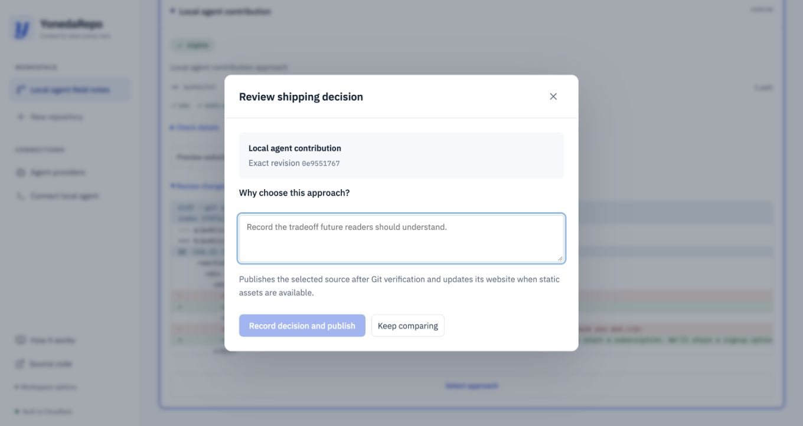

# YonedaRepo — Agent-First Repository

An API-first, Git-like transactional model where agents fetch only what they need, coordinate changes, and preserve context.

[Try it at yonedarepo.com](https://yonedarepo.com/) · [Submission](docs/submission.md) · [Architecture](docs/current-state-architecture.md) · [Release evidence](docs/release-evidence.md)



## What it does

- **Fetch only what you need.** Each agent gets a frozen, bounded packet of prior context and either an isolated Git fork or a lazy, server-side source view that loads files on demand without a clone.
- **Coordinate changes.** One transactional ledger per repository holds the task graph, durable peer messages and working branches that advance only when the expected version still matches. Stale or conflicting results wake a coordinator that reconciles them and gets fresh checks.
- **Preserve context.** Intent, agent claims, independent checks and human decisions link to exact revisions in a typed graph. The next run inherits that history.
- **Agent claims are not authority.** Trusted capture builds fresh Git objects, a clean evaluator checks that exact revision against a protected test bundle, and a human decides what ships. Git remains the canonical, compatible history.

## Try it

- **Reviewers:** open [yonedarepo.com](https://yonedarepo.com/), choose **Have a reviewer access key?** and enter the key. Then open the **guided demo**: build together → continue from context → reconcile concurrent changes → review and publish. The guided demo is available to reviewer accounts only.
- **Everyone else:** sign up, save the recovery code, connect your own provider key under **Connect Agents**, add a repository and choose **Start a Run**.
- **Read-only CLI** (Node 24, starts no inference): `node tools/reviewer.mjs --checked`. It prompts for the key without echoing it.
- Publication is always a separate human decision. Opening forms or sample briefs starts no work.

## How a run works

- **Start a Run** with one **Auto** agent. The planner picks one to six approved agents when the work justifies a team, freezes their scopes and integrates one checked result.
- **Compare two approaches** runs two independent builders, checks both, then a read-only reviewer recommends one. You can override it with a reason.
- Runs are bounded: 144 model requests, at most three concurrent agents, 20 executions and two repair rounds, all within the shared workspace allowance.
- Providers: OpenAI/Codex, Anthropic/Claude, ZAI (GLM), MiMo and Google/Gemini. Keys are sealed per workspace and injected by the Worker; agents never hold them. See [providers](docs/providers.md).
- Your own agent can join through scoped MCP and Git. See [the MCP guide](docs/remote-mcp.md).

More: [build together](docs/build-together.md) · [website workflow](docs/website-workflow.md) · [context usage](docs/context-usage.md) · [logging](docs/logging.md)

## Architecture

Rust owns the domain, transactional ledger, native agent supervisor, MCP server, source capture and verifier. Cloudflare runs it:

- **Workers:** the platform Worker (auth, API, remote MCP, scoped Git and source APIs, queue consumers, credential brokers) plus isolated Sites and Apps Workers.
- **Durable Objects** (Rust → Wasm, SQLite): Repository (the authority), Workspace, Source views and Live updates.
- **Containers** run agent harnesses, capture, evaluation and publication with internet off; all egress goes through Worker brokers.
- **Artifacts** for canonical Git and per-attempt forks · **Queues** fed by a transactional outbox · **R2** for evidence and blobs · **D1** as a rebuildable index.

**Roadmap (not built):** a transactional layer over source in the spirit of the Delta Lake log: an append-only changeset log as the source of truth, optimistic concurrency with path-level conflicts, snapshot reads and Git exported for compatibility. See [the architecture](docs/current-state-architecture.md).

## Run locally

Requires the pinned Rust toolchain, Node 24, pnpm 11, Docker and `worker-build` 0.8.7.

```sh
cargo install worker-build --version 0.8.7 --locked
cargo xtask doctor
cargo xtask setup
cargo xtask check   # full local gate, no provider keys or paid inference
cargo xtask dev     # http://localhost:8787 (sites on :8788)
```

For browser hot reload, keep Wrangler running and run `pnpm --dir frontend dev`.

## Deploy to your own Cloudflare account

- **Requirements:** Workers Paid, Containers, R2, Queues and [Artifacts access](https://developers.cloudflare.com/artifacts/get-started/workers/), plus a `workers.dev` subdomain.
- **Sign in:** `cargo xtask setup`, then `pnpm exec wrangler login`.
- **Create D1 once** with a minimal config that can't target our account:

  ```sh
  mkdir -p .local/bootstrap
  echo '{"account_id":"YOUR_ACCOUNT_ID","name":"my-yoneda","compatibility_date":"2026-10-07"}' > .local/bootstrap/wrangler.json
  pnpm exec wrangler d1 create my-yoneda-index --config .local/bootstrap/wrangler.json
  ```

- **Configure:**

  ```sh
  cargo xtask cloudflare-configure --name my-yoneda --account-id YOUR_ACCOUNT_ID \
    --subdomain YOUR_SUBDOMAIN --namespace my-yoneda --database-id YOUR_D1_UUID
  ```

- **Create the R2 bucket and queues once:**

  ```sh
  C=.local/deploy/my-yoneda/platform.json
  pnpm exec wrangler r2 bucket create my-yoneda-objects --config $C
  for q in dead-letter agent capture evaluate publish; do pnpm exec wrangler queues create my-yoneda-$q --config $C; done
  ```

- **Deploy:** `cargo xtask cloudflare-deploy --name my-yoneda` (add `--dry-run` first). It builds, migrates D1, deploys the platform, container and sites Workers, and checks health. It starts no paid inference.
- **Run locally against your account:** `cargo xtask dev --name my-yoneda`.
- **Back up** `.local/deploy/my-yoneda/owner-token` and `vault-key` privately. Losing the vault key makes stored provider keys unreadable.

Details: [runbook](docs/runbook.md) · [public metadata and custom domains](docs/public-metadata.md)

## Repository

```text
frontend/            Browser app (React 19, React Flow)
backend/crates/
  yoneda-core/       Contracts and pure validation
  yoneda-app/        Transactional commands, graph and DO migrations
  yoneda-cloudflare/ Rust binding interoperability
  yoneda-worker/     Rust Durable Objects
  yoneda-runtime/    Native supervisor, MCP, capture and evaluation
cloudflare/          Worker adapters, sites, container image, D1 migrations, Wrangler config
shared/              Contracts shared with TypeScript
xtask/               Developer and deployment commands
tests/               Cross-boundary workerd, runtime and container tests
fixtures/            Small demo repositories
docs/                Architecture, operations and verification evidence
```

[Engineering standards](AGENTS.md) · [Implementation ledger](docs/progress.md) · Apache-2.0
